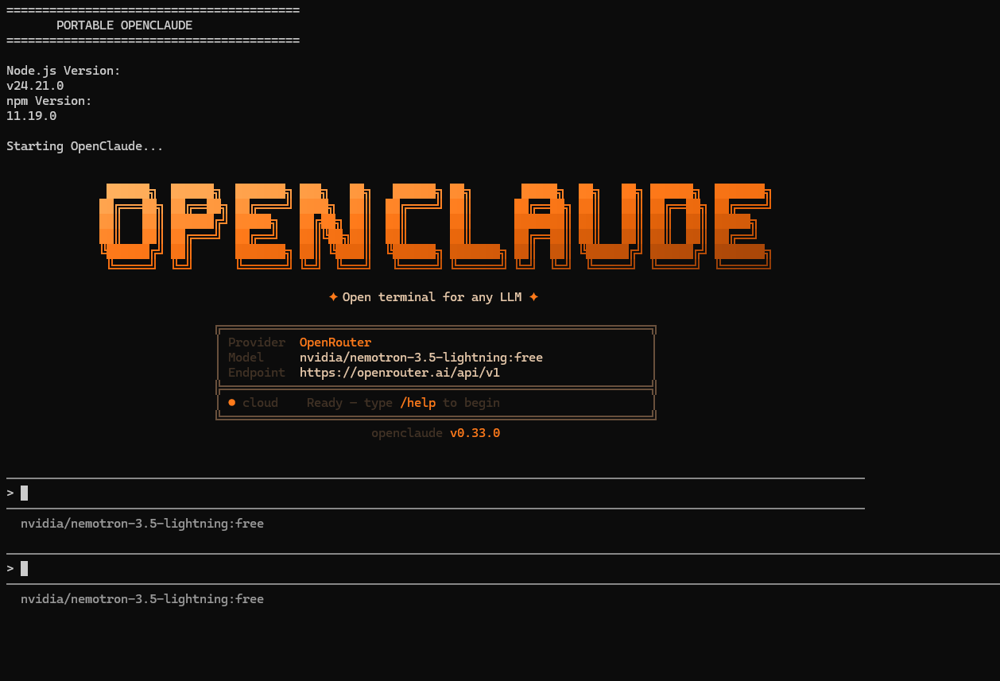

# ⚡ Portable OpenClaude

### Your OpenClaude environment. Portable. Simple. Ready to go.

A Windows-friendly setup that keeps Node.js and npm's global environment inside one project folder—without requiring a traditional system-wide Node.js installation.

<p align="center">
  
  
  <a href="LICENSE"></a>
</p>

<p align="center">
  <a href="https://github.com/nominda/Portable-OpenClaude">View Repository</a> ·
  <a href="https://github.com/nominda/Portable-OpenClaude/issues">Report an Issue</a>
</p>

---

## ✨ Why Portable OpenClaude?

Getting a portable command-line environment set up manually can be a hassle. This project automates the initial setup with two Windows batch files.

- 📦 **Portable runtime** — downloads Node.js into the project folder.
- 🔐 **SHA-256 verification** — checks the downloaded archive before extracting it.
- 🧰 **Local npm environment** — keeps global packages and npm cache in project-local folders.
- 🚀 **One-click setup** — prepares the environment and installs OpenClaude.
- ▶️ **Simple launcher** — start OpenClaude using a separate batch file.
- 💾 **Movable folder** — designed to be copied to another compatible Windows PC or USB drive.

> **Please note:** Initial setup needs an internet connection. Portability can depend on OpenClaude, its dependencies, authentication, network access, and the target PC's policies.

---

## 🖥️ Screenshot

<p align="center">
  
</p>

<p align="center">
  <em>OpenClaude running in a Windows terminal.</em>
</p>

---

## 🚀 Quick Start

### 1. Get the project

Download the repository using **Code → Download ZIP**, then extract it to a folder you can write to.

Or clone it with Git:

```bash
git clone https://github.com/nominda/Portable-OpenClaude.git
cd Portable-OpenClaude
```

### 2. Set it up

Double-click:

```text
Setup-OpenClaude.bat
```

The setup script is designed to:

1. Download the configured official Node.js for Windows x64.
2. Verify the archive's SHA-256 checksum.
3. Extract Node.js into the project directory.
4. Create local npm global and cache directories.
5. Install `@twigpine/openclaude@latest`.
6. Check that the OpenClaude launcher was created.

Wait until setup reports that it completed successfully.

### 3. Launch OpenClaude

Double-click:

```text
Launch-OpenClaude.bat
```

Follow any prompts shown by OpenClaude, including any required authentication or configuration.

---

## 📁 Project Layout

The repository starts with these files:

```text
Portable-OpenClaude/
├── Setup-OpenClaude.bat    # Downloads and installs the environment
├── Launch-OpenClaude.bat   # Starts OpenClaude
├── README.md               # Project documentation
├── .gitignore              # Excludes generated files
└── LICENSE                 # MIT license
```

The screenshot is stored separately:

```text
Portable-OpenClaude/
└── screenshots/
    └── claude-cli.png      # CLI screenshot shown above
```

After setup, these folders are created or populated locally:

```text
Portable-OpenClaude/
├── node/                   # Portable Node.js runtime
├── npm-global/             # Global npm packages
└── npm-cache/              # npm cache
```

These generated folders are intentionally excluded from the Git repository. Keep them when copying an already configured environment to another PC.

---

## 🖥️ Requirements

| Requirement | Details |
|---|---|
| Operating system | Windows 10 or Windows 11, 64-bit |
| Initial setup | Internet connection |
| Built-in tools | Windows PowerShell |
| Storage | Enough free space for Node.js and npm packages |
| Permissions | Write access to the project folder |

Some school, workplace, or managed computers may block downloads, scripts, or command-line applications.

---

## 💾 Using It on Another PC or USB Drive

1. Run setup and make sure it completes successfully.
2. Close OpenClaude.
3. Copy the **entire project folder**, including `node/`, `npm-global/`, and `npm-cache/`, to the destination.
4. On the other compatible Windows PC, run `Launch-OpenClaude.bat`.

The folder is designed to be portable, but it is **not guaranteed to work on every PC**. You may need to authenticate again, and OpenClaude or its dependencies may have additional system requirements. The first setup requires internet access.

---

## 🛠️ Troubleshooting

<details>
<summary><strong>Node.js download or extraction fails</strong></summary>

- Check your internet connection.
- Check whether a firewall or managed network blocks `nodejs.org`.
- Run setup again after checking the error shown in the window.

</details>

<details>
<summary><strong>SHA-256 verification fails</strong></summary>

Do not use the rejected archive. Retry the download and confirm that the checksum configured in the setup script matches the official Node.js release archive.

</details>

<details>
<summary><strong>OpenClaude installation fails</strong></summary>

- Read the npm error printed in the setup window.
- Check internet access and any package requirements.
- Retry setup after resolving the reported issue.

</details>

<details>
<summary><strong>The launcher says OpenClaude is missing</strong></summary>

Run `Setup-OpenClaude.bat` again and confirm that the npm installation completes and creates `npm-global\openclaude.cmd`.

</details>

<details>
<summary><strong>The screenshot does not appear on GitHub</strong></summary>

- Confirm that the image is committed to the repository.
- Check that the file is named `claude-cli.png`.
- Make sure its location is exactly `screenshots/claude-cli.png`.
- Check that the filename and folder capitalization match the README image path.

</details>

---

## 🔒 Security

- Review the batch files before running them.
- Download Node.js only from the official site: [nodejs.org](https://nodejs.org/).
- Do not commit API keys, access tokens, passwords, or personal configuration files.
- A checksum confirms that the downloaded archive matches the expected hash; it does not replace careful review of the scripts and their sources.

---

## 📜 License

This project is distributed under the [MIT License](LICENSE).

---

<p align="center">
  Made with ⚡ by <a href="https://github.com/nominda"><strong>Nominda Yasasvin</strong></a>
  <br>
  <sub>If this project helps you, consider giving the repository a ⭐ on GitHub.</sub>
</p>
